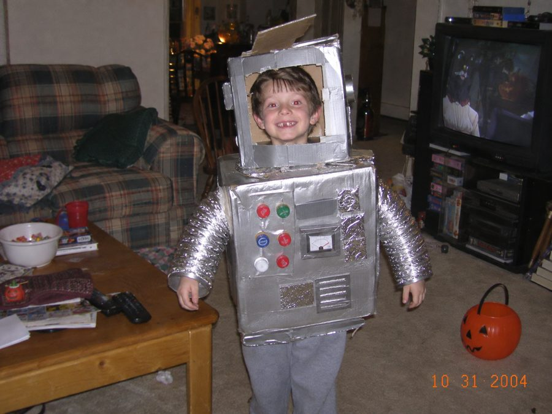
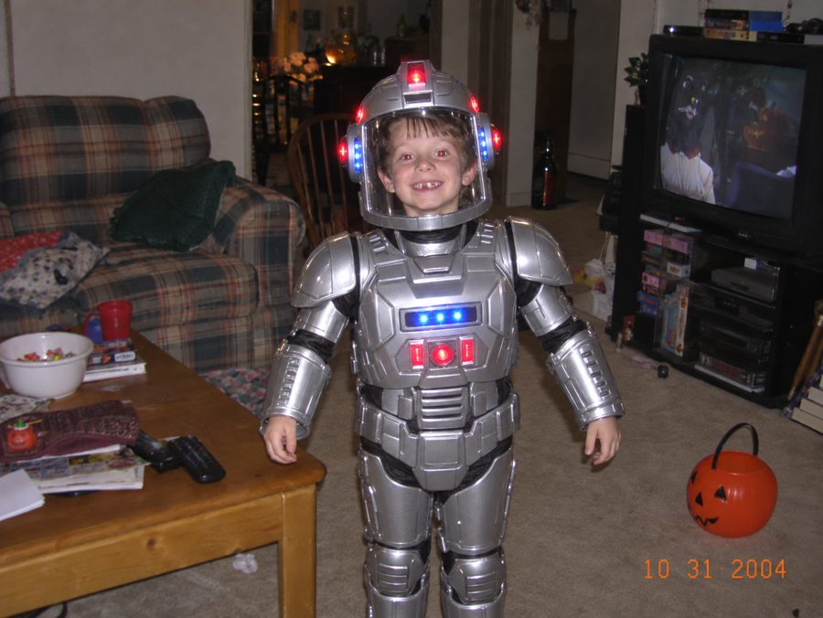
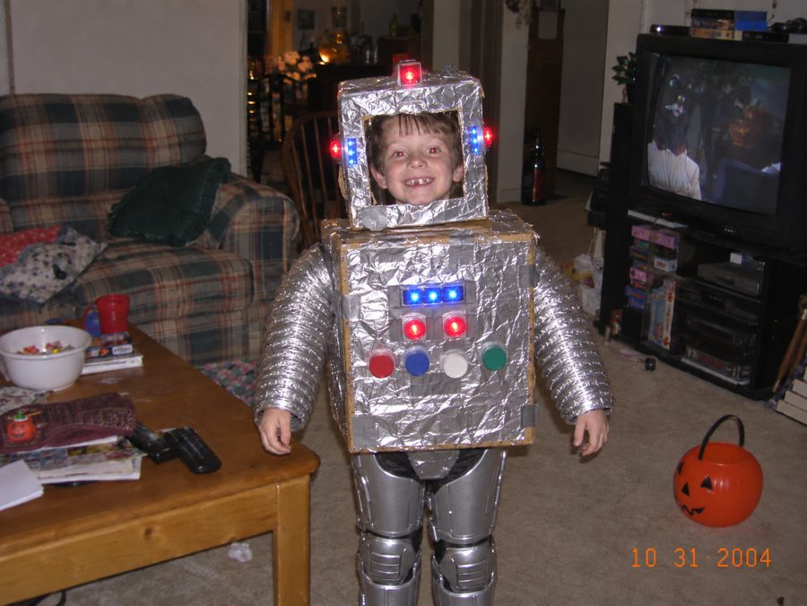
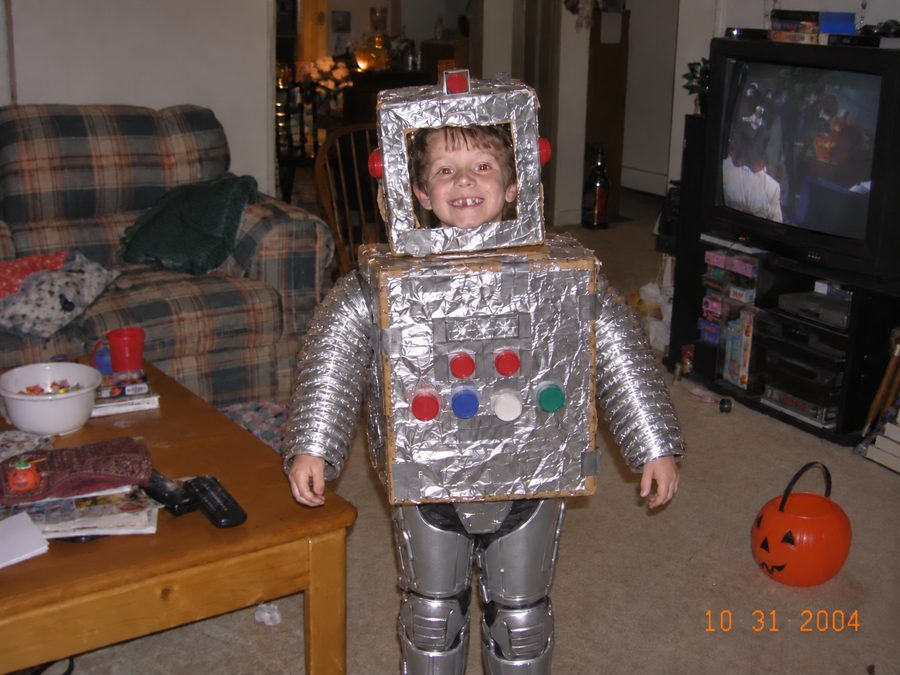
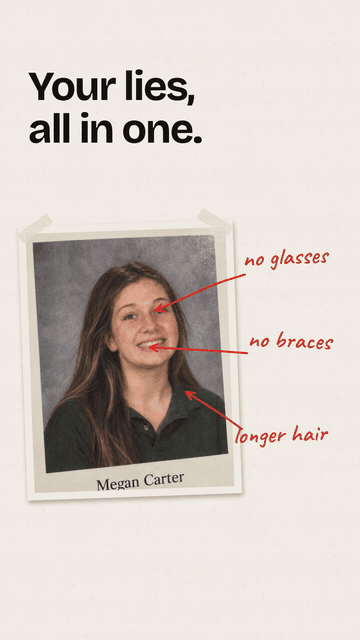

# "I'm so sorry, I lied" — chained photo edits that undo one lie at a time

Prompt templates (and a small runnable script) for the TikTok "I'm so sorry / I lied" trend:
slide 1 is an AI-perfected version of a real photo, every next slide takes back exactly one lie,
and the last slide is the untouched original.

This is the prompt chain behind [imsosorryilied.app](https://imsosorryilied.app/?utm_source=github&utm_medium=readme&utm_campaign=prompt_chain).
Published so you can do it yourself with any image-edit model. Tested on Nano Banana 2 / 2.1, Seedream 4.5 and GPT Image 2.5
(notes below). Every person in `examples/` is AI-generated and does not exist.

| Original | Step 1: every lie applied | Step 2: undo "store-bought" | Step 3: undo "LED lights" |
|---|---|---|---|
|  |  |  |  |



## The chain

For `n` lies you make `n` images. Image 1 applies all lies. Image `k ≥ 2` starts from image `k-1` and undoes lie `k-1`.
The real photo is slide `n+1`; it is never generated.

### Every prompt starts with the same keep-block

```
Keep the same person with the exact same face, identity, age, expression, pose, framing,
camera angle, background, lighting and photo quality. Do not change anything that is not listed.
Do not add any text, letters, numbers or logos that are not already in the photo.
```

The last sentence exists because Nano Banana 2.1 once wrote "BOO!" on a ghost costume and kept it for the whole chain.

### Step 1 — the perfect version

```
{KEEP} {THEME_RULE}
Edit the photo so that all of these are true: {lie 1}; {lie 2}; {lie 3}.
Make each change look natural and believable, as if the photo had really been taken that way.
```

`THEME_RULE` for Halloween costumes:
`This is a Halloween costume photo. Make the costume a polished, store-quality version of the SAME costume theme and character. Never switch to a different costume or character.`
For baby photos: `This is a baby photo. Keep it the same baby at the same age.`

### Step k — undo exactly one lie

```
Keep the first image identical except one change: undo "{lie k-1}" so that {negated lie}.
The second image is the original photo, for reference only: make that one detail look exactly
as it does there (same materials, colors and shapes) and copy nothing else from it.
These must stay exactly as they are in the first image: {lie k}; {lie k+1}; ...
Do not alter anything else. This is a Halloween costume photo. Keep the same costume theme and character.
```

Three things that turned out to matter, in order of how much they helped:

1. **Pass the original photo as a second image on undo steps.** Without it, "undo store-bought" never produced
   the cardboard costume again on any model. With it, Nano Banana 2.1 got it right.
2. **List the lies that must stay.** With only the original as reference, the model copied it wholesale and
   dropped later lies a step early.
3. **Drop the "store-quality" rule from undo steps.** It fought "undo store-bought" directly.

Hair lies get one extra sentence, because all four models curled "long straight hair":
`For hair, match the length and texture described exactly (straight means no curls or waves).`

## Model notes (6 synthetic photos × 3 steps, October 2026)

| Model | Steps OK | Faces | Notes |
|---|---|---|---|
| Nano Banana 2 | 18/18 | stable | skin a bit orange; never undid "store-bought" |
| **Nano Banana 2.1** | 18/18 | stable | steadiest colors, about half the price of NB2; the only one that undid "store-bought"; adds decorations unless told not to |
| Seedream 4.5 | 18/18 | swapped the person once | carried tape from the real print into the "perfect" one; exposure drifted |
| GPT Image 2.5 (high) | 16/18 | stable | refused one baby step; edits too timid |

Still open: big costume reversals sometimes bounce back two steps later. PRs with tricks welcome.

## Run it

```sh
pip install requests
export FAL_KEY=...            # fal.ai key; the script uses google/nano-banana-2.1/edit
python chain.py photo.jpg --theme costume "it was store-bought" "it had LED lights" "I had matching boots"
```

Outputs `out/step-1.png … step-n.png`. Add the captions and your real photo in CapCut or TikTok photo mode.

## License

MIT for the prompts and code. The example images are AI-generated samples; reuse them with the "AI-generated" note.
